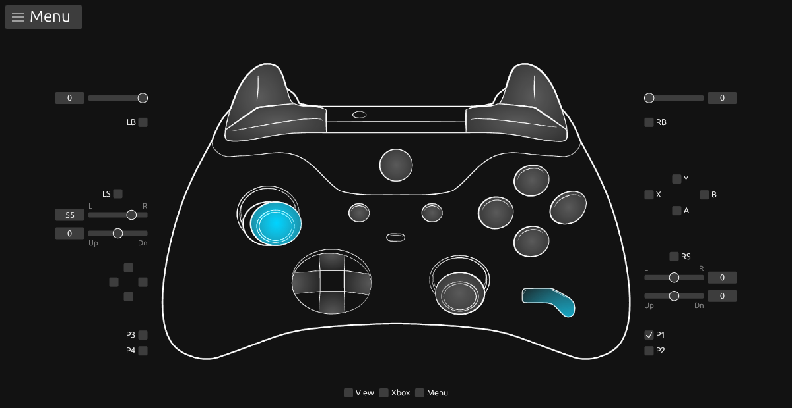
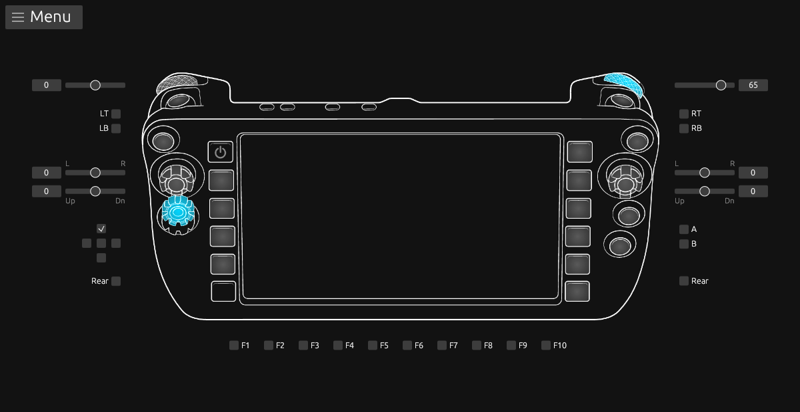
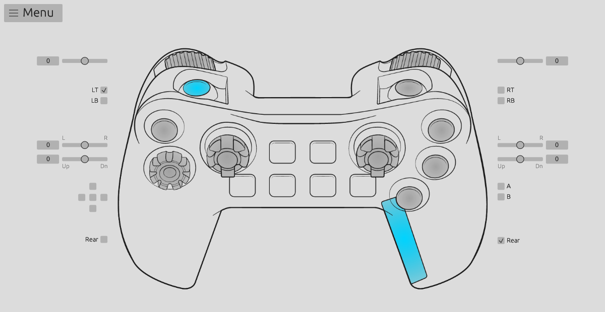
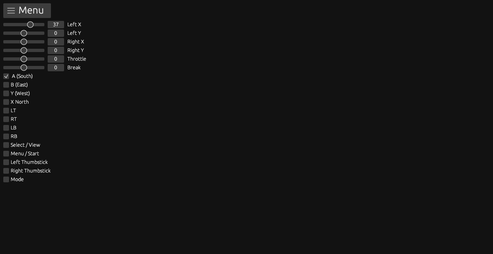

# Linux Virtual Joystick
This is a simple program that creates a virtual joystick on your computer. I use it to develop software that needs a joystick, without actually having a joystick on-hand. it was inspired by the basic functionality of [vJoy](http://vjoystick.sourceforge.net/site/). 

## Joystick Options

#### Xbox Elite 2 (default)



<table>
  <tr>
    <th>SRoC Tab Active5</th>
    <th>SRoC DualGrip</th>
    <th>Linux Virtual Joystick</th>
  </tr>
  <tr>
    <td width="33%"></td>
    <td width="33%"></td>
    <td width="33%"></td>
  </tr>
</table>

Interact with the joystick by dragging the image's joystick pads or clicking on the image's button. To set persistent inputs, use the controls surrounding the controller image.

## Build from Source

Clone this repository using its **Code** button, then run the following commands
from the cloned directory. If you are viewing a fork, use that fork's clone URL.

```
# apt dependencies
sudo apt install git curl build-essential -y

# install rust/cargo
curl --proto '=https' --tlsv1.2 -sSf https://sh.rustup.rs | sh

# restart terminal so cargo is added to PATH

# build and run
cargo build
sudo -E ~/.cargo/bin/cargo run
```
